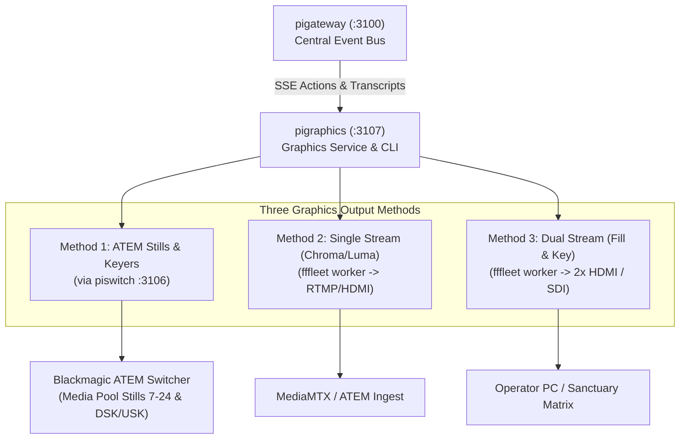

# pigraphics

Broadcast graphics engine, composition microservice, and CLI for the **Pi Ecosystem** (`piecosystem`).

`pigraphics` manages template-based on-air graphics, dynamic lower-thirds, scripture citations, bugs, ticker banners, and live subtitles. It renders broadcast-grade CSS animations and serves dynamic HTML overlays executed by headless Chromium workers (`fffleet`). It also integrates directly with Blackmagic ATEM switchers through `piswitch` and coordinates with the central event bus in `pigateway`.

---

## Architecture & Integration in the Pi Ecosystem



- **Port**: `3107` (adjacent to `pitube` :3105, `piswitch` :3106, and `pispace` :3108).
- **Central Event Bus**: Listens to `pigateway` SSE (`/api/v1/events`) for `graphic.show`, `graphic.hide`, `lowerthird.set`, rundown cues, and speaker updates.
- **Internal SSE stream**: `GET /api/v1/graphics/events` pushes state changes and bindings to running display pages and UI consoles.

---

## The Three Output Methods

### Method 1: Media Player & ATEM Animations (via `piswitch`)
- Renders template into raw RGBA broadcast stills.
- Uploads still into `piswitch`'s dedicated 18-slot graphics pool (slots `7..24`).
- Directs ATEM Media Player 1 or 2 to the slot.
- Controls Downstream Keyer (DSK) / Upstream Keyer (USK) on-air, auto transitions, and ties.
- Multiple active graphics can be assigned to different still slots or pre-composited onto a unified still.

### Method 2: Single Live Video Stream (Chroma or Luma Key)
- Serves dynamic `/display?mode=chroma&keyColor=#00B140` HTML page.
- Dispatches streaming job to `fffleet-worker` (or local Playwright + FFmpeg).
- Chromium renders CSS animations live against green or black matte, pushing single H.264 stream to RTMP or HDMI.

### Method 3: Dual Live Video Streams (Fill & Key Streams)
- Streams two synchronized feeds: **Fill** (RGB graphics on black) and **Cut/Key** (alpha matte extracted via FFmpeg filter `[0:v]split=2[fill_in][key_in]; [fill_in]format=yuv420p[fill]; [key_in]alphaextract,format=yuv420p[key]`).
- Outputs to two HDMI outputs on operator PC or two ATEM SDI inputs.
- Single FFmpeg pipeline guarantees zero-drift synchronization between fill and cut.

---

## Broadcast CSS Animations & Dynamic Bindings

The template engine includes broadcast keyframes:
- **Slides**: `slideInLeft`, `slideInRight`, `slideInUp`, `slideInDown`, `slideOutLeft`, `slideOutRight`, `slideOutUp`, `slideOutDown`
- **Fades & Zooms**: `fadeIn`, `fadeOut`, `zoomIn`, `zoomOut`
- **Effects**: `pulse`, `blink`, `lowerThirdStrap`, `typewriter`
- **Live Bindings**: Elements with `data-binding="speaker"` or `data-binding="title"` automatically update over SSE without reloading the page.

---

## HTTP API Summary

| Method | Endpoint | Description |
| :--- | :--- | :--- |
| `GET` | `/health` | Service health status |
| `GET` | `/api/v1/status` | Extended status: active graphics, templates, live stream state |
| `GET` | `/api/v1/graphics/templates` | List all graphic templates |
| `GET` | `/api/v1/graphics/templates/:id` | Fetch template definition |
| `POST` | `/api/v1/graphics/templates` | Create or update graphic template |
| `DELETE` | `/api/v1/graphics/templates/:id` | Delete graphic template |
| `GET` | `/api/v1/graphics/active` | List currently active on-air graphics |
| `POST` | `/api/v1/graphics/active/show` | Trigger/show graphic on air (with bindings, autoHideMs) |
| `POST` | `/api/v1/graphics/active/hide/:instanceId` | Hide active graphic instance |
| `POST` | `/api/v1/graphics/active/clear` | Clear all on-air graphics |
| `GET` | `/api/v1/graphics/bindings` | Get current live variable bindings |
| `POST` | `/api/v1/graphics/bindings` | Update variable bindings |
| `GET` | `/display` / `/overlay` | Full-screen broadcast HTML overlay page |
| `GET` | `/api/v1/graphics/events` | Server-Sent Events stream for real-time graphics updates |
| `POST` | `/api/v1/graphics/atem/push` | Render still, upload to slot 7..24, set Media Player & DSK |
| `POST` | `/api/v1/graphics/atem/dsk/on-air` | Set ATEM DSK on/off air |
| `POST` | `/api/v1/graphics/stream/start` | Start live stream via fffleet (single or dual fill/key) |
| `POST` | `/api/v1/graphics/stream/stop` | Stop live stream |

---

## CLI Usage

```bash
# Check status
pigraphics status

# List templates
pigraphics templates list

# Show lower third with speaker bindings
pigraphics show lower-third-speaker --speaker "Pastori Juha" --title "Riihimäen Keskuskirkko" --auto-hide 7000

# Hide graphic instance
pigraphics hide inst-lower-third-speaker-12345

# Clear all graphics on air
pigraphics clear

# Method 1: Push still to ATEM via piswitch
pigraphics atem push lower-third-speaker --slot 7 --dsk 1

# Method 2 & 3: Live streaming via fffleet
pigraphics stream start --mode dual-fill-key
pigraphics stream stop
```

---

## Configuration

Set environment variables in `.env` or system environment:

```env
PIGRAPHICS_PORT=3107
PIGRAPHICS_HOST=0.0.0.0
PIGRAPHICS_DATA_DIR=data
PIGATEWAY_URL=http://localhost:3100
PISWITCH_URL=http://localhost:3106
FFFLEET_URL=http://localhost:5000
FFFLEET_TOKEN=
GRAPHICS_RTMP_BASE=rtmp://localhost:1935/live
```

---

## Development & Testing

```bash
# Install dependencies
npm install

# Run unit and integration tests
npm test

# Build TypeScript
npm run build

# Start dev server with watch
npm run dev
```
